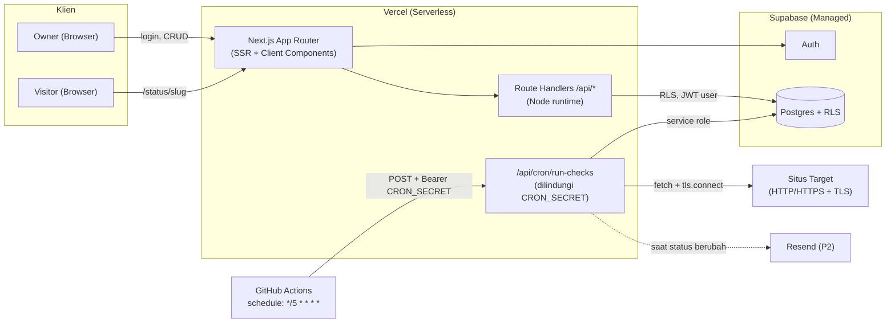
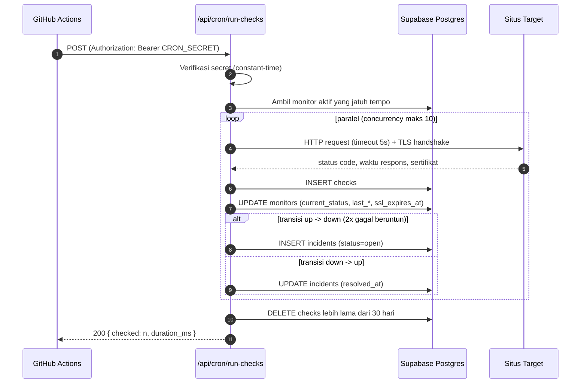
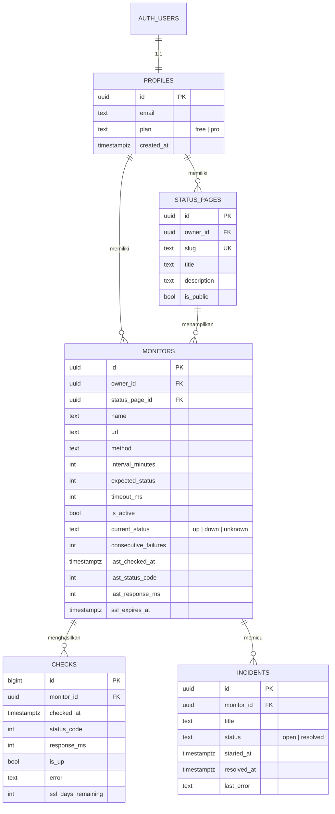

# PRD: StatusWatch — Uptime & SSL Monitor + Public Status Page

> Dokumen ini adalah sumber kebenaran tunggal (single source of truth) untuk agent coding.
> Kerjakan sesuai **urutan di Bagian 15**, centang tiap *Definition of Done* sebelum lanjut.
> Jangan menambah fitur di luar lingkup (Bagian 3) tanpa persetujuan.

---

## 1. Ringkasan Produk

**StatusWatch** adalah layanan SaaS berbasis web untuk memantau ketersediaan (uptime), kecepatan respons, dan masa berlaku sertifikat SSL dari situs web/API. Pengguna mendaftarkan URL yang ingin dipantau, sistem mengeceknya secara berkala dari cloud (*agentless*, tanpa instalasi apa pun di server target), lalu hasilnya ditampilkan di dashboard privat dan **halaman status publik** yang bisa dibagikan ke siapa saja.

**Tagline:** *"Tahu duluan sebelum pelanggan Anda tahu."*

### 1.1 Masalah
- UMKM, mahasiswa, dan developer solo sering baru tahu situsnya mati dari keluhan pengguna.
- Sertifikat SSL kedaluwarsa tanpa disadari sehingga browser menampilkan peringatan "Not Secure".
- Tidak ada cara sederhana dan gratis untuk menunjukkan status layanan secara transparan kepada pelanggan.

### 1.2 Solusi
Monitoring otomatis + deteksi insiden otomatis + halaman status publik, semuanya dari satu aplikasi web yang bisa dipakai banyak pengguna (multi-tenant).

### 1.3 Sasaran Proyek (konteks mata kuliah Cloud Computing)
| Sasaran | Bukti di aplikasi |
|---|---|
| Model layanan **SaaS** | Multi-tenant, akses via browser, paket langganan simulasi |
| Arsitektur cloud-native | Serverless (Vercel), managed DB (Supabase), scheduler terpisah (GitHub Actions) |
| Skalabilitas & keamanan dasar | RLS per tenant, rate limit, proteksi SSRF, secret di env |
| Demo publik | URL publik `*.vercel.app` + halaman `/status/[slug]` |

---

## 2. Persona & Aktor

| Aktor | Deskripsi | Kebutuhan utama |
|---|---|---|
| **Owner (pengguna terdaftar)** | Pemilik situs/UMKM/developer | Daftarkan URL, lihat status & grafik, kelola halaman status, terima notifikasi |
| **Visitor (publik)** | Pelanggan/orang yang membuka link status | Lihat status layanan terkini tanpa login |
| **System (scheduler)** | GitHub Actions memanggil endpoint cron | Menjalankan pengecekan berkala, membuka/menutup insiden |

**Persona contoh:** *Rina, pemilik toko online UMKM.* Ia ingin tahu kalau tokonya down dan ingin memberi link status ke pelanggan saat terjadi gangguan.

---

## 3. Lingkup

### 3.1 In Scope (MVP)
- P0: Auth, CRUD monitor, pengecekan HTTP + SSL, riwayat check, dashboard, halaman status publik, deteksi insiden otomatis, paket Free/Pro simulasi, deploy Vercel.
- P1: Grafik response time, perhitungan uptime 24j/7h/30h, tombol "Check now", filter & pencarian monitor, retensi data otomatis.
- P2 (hanya jika waktu cukup): Notifikasi email (Resend), update insiden manual, tema gelap, ekspor CSV.

### 3.2 Out of Scope
- **Tidak ada fitur AI** pada versi ini.
- Pembayaran sungguhan (paket hanya simulasi).
- Monitoring TCP/ICMP/DNS/port, monitoring dari banyak lokasi/region.
- Aplikasi mobile native, SSO/OAuth pihak ketiga, custom domain untuk status page.
- Integrasi Slack/Telegram/webhook.

---

## 4. Tech Stack (WAJIB, jangan diganti)

| Lapisan | Teknologi |
|---|---|
| Framework | **Next.js 15 (App Router) + TypeScript** |
| Styling/UI | **Tailwind CSS + shadcn/ui**, ikon `lucide-react` |
| Grafik | **Recharts** |
| Database & Auth | **Supabase** (Postgres + Supabase Auth) |
| Client Supabase | `@supabase/supabase-js` + `@supabase/ssr` |
| Validasi | **Zod** |
| Hosting | **Vercel** (Hobby) |
| Scheduler | **GitHub Actions** (cron tiap 5 menit) |
| Email (P2) | Resend |
| Package manager | npm |

---

## 5. Arsitektur Sistem

### 5.1 Diagram Arsitektur



### 5.2 Alur Pengecekan Berkala (Sequence)



### 5.3 Prinsip Arsitektur
1. **Pemisahan akses data:** operasi pengguna memakai JWT + RLS; operasi cron dan halaman publik memakai **service role** hanya di server.
2. **Service role key tidak boleh** muncul di kode klien atau diberi awalan `NEXT_PUBLIC_`.
3. **Stateless:** semua state di Postgres, tidak ada state di memori fungsi.
4. **Idempotent cron:** menjalankan cron dua kali berdekatan tidak boleh menggandakan insiden (gunakan unique partial index, lihat Bagian 7).
5. **Fail-safe:** error satu monitor tidak boleh menghentikan monitor lain (`Promise.allSettled`).

---

## 6. Struktur Folder

```
statuswatch/
├─ app/
│  ├─ (marketing)/page.tsx                 # Landing page
│  ├─ (auth)/login/page.tsx
│  ├─ (auth)/register/page.tsx
│  ├─ (app)/layout.tsx                     # Layout dashboard + guard auth
│  ├─ (app)/dashboard/page.tsx             # Ringkasan semua monitor
│  ├─ (app)/monitors/new/page.tsx
│  ├─ (app)/monitors/[id]/page.tsx         # Detail: grafik, riwayat, insiden
│  ├─ (app)/monitors/[id]/edit/page.tsx
│  ├─ (app)/status-pages/page.tsx          # Kelola status page
│  ├─ (app)/settings/page.tsx              # Profil + paket
│  ├─ status/[slug]/page.tsx               # HALAMAN PUBLIK
│  └─ api/
│     ├─ monitors/route.ts                 # GET list, POST create
│     ├─ monitors/[id]/route.ts            # GET, PATCH, DELETE
│     ├─ monitors/[id]/check/route.ts      # POST "Check now"
│     ├─ status-pages/route.ts
│     ├─ status-pages/[id]/route.ts
│     ├─ plan/route.ts                     # PATCH ganti paket (simulasi)
│     └─ cron/run-checks/route.ts          # Dipanggil GitHub Actions
├─ components/
│  ├─ ui/                                  # shadcn
│  ├─ monitor-card.tsx
│  ├─ monitor-form.tsx
│  ├─ status-badge.tsx
│  ├─ response-chart.tsx
│  ├─ uptime-bar.tsx                       # Bar 90 segmen harian
│  └─ incident-list.tsx
├─ lib/
│  ├─ supabase/{client,server,admin}.ts
│  ├─ checker/{http-check,ssl-check,run-check,ssrf-guard}.ts
│  ├─ uptime.ts                            # Hitung % uptime
│  ├─ plans.ts                             # Definisi paket & limit
│  ├─ validators.ts                        # Skema Zod
│  └─ rate-limit.ts
├─ supabase/migrations/0001_init.sql
├─ .github/workflows/run-checks.yml
├─ .env.example
└─ prd.md
```

---

## 7. Model Data (Supabase / Postgres)

### 7.1 ERD



### 7.2 SQL Migrasi (`supabase/migrations/0001_init.sql`)

```sql
-- ============ EXTENSIONS ============
create extension if not exists "pgcrypto";

-- ============ TABLES ============
create table public.profiles (
  id uuid primary key references auth.users(id) on delete cascade,
  email text not null,
  plan text not null default 'free' check (plan in ('free','pro')),
  created_at timestamptz not null default now()
);

create table public.status_pages (
  id uuid primary key default gen_random_uuid(),
  owner_id uuid not null references public.profiles(id) on delete cascade,
  slug text not null unique check (slug ~ '^[a-z0-9]([a-z0-9-]{1,38})[a-z0-9]$'),
  title text not null check (char_length(title) between 1 and 80),
  description text check (char_length(description) <= 300),
  is_public boolean not null default true,
  created_at timestamptz not null default now()
);

create table public.monitors (
  id uuid primary key default gen_random_uuid(),
  owner_id uuid not null references public.profiles(id) on delete cascade,
  status_page_id uuid references public.status_pages(id) on delete set null,
  name text not null check (char_length(name) between 1 and 80),
  url text not null check (char_length(url) <= 2048),
  method text not null default 'GET' check (method in ('GET','HEAD')),
  interval_minutes int not null default 5 check (interval_minutes in (5,10,30,60)),
  expected_status int not null default 200 check (expected_status between 100 and 599),
  timeout_ms int not null default 5000 check (timeout_ms between 1000 and 8000),
  is_active boolean not null default true,
  current_status text not null default 'unknown' check (current_status in ('up','down','unknown')),
  consecutive_failures int not null default 0,
  last_checked_at timestamptz,
  last_status_code int,
  last_response_ms int,
  ssl_expires_at timestamptz,
  created_at timestamptz not null default now()
);
create index monitors_owner_idx on public.monitors(owner_id);
create index monitors_due_idx on public.monitors(is_active, last_checked_at);
create index monitors_status_page_idx on public.monitors(status_page_id);

create table public.checks (
  id bigint generated always as identity primary key,
  monitor_id uuid not null references public.monitors(id) on delete cascade,
  checked_at timestamptz not null default now(),
  status_code int,
  response_ms int,
  is_up boolean not null,
  error text,
  ssl_days_remaining int
);
create index checks_monitor_time_idx on public.checks(monitor_id, checked_at desc);

create table public.incidents (
  id uuid primary key default gen_random_uuid(),
  monitor_id uuid not null references public.monitors(id) on delete cascade,
  title text not null,
  status text not null default 'open' check (status in ('open','resolved')),
  started_at timestamptz not null default now(),
  resolved_at timestamptz,
  last_error text
);
create index incidents_monitor_idx on public.incidents(monitor_id, started_at desc);
-- Idempotensi: maksimal 1 insiden OPEN per monitor
create unique index one_open_incident_per_monitor
  on public.incidents(monitor_id) where status = 'open';

-- ============ AUTO-PROFILE SAAT REGISTER ============
create or replace function public.handle_new_user()
returns trigger language plpgsql security definer set search_path = public as $$
begin
  insert into public.profiles (id, email) values (new.id, new.email);
  return new;
end $$;

create trigger on_auth_user_created
  after insert on auth.users
  for each row execute function public.handle_new_user();

-- ============ ROW LEVEL SECURITY ============
alter table public.profiles enable row level security;
alter table public.status_pages enable row level security;
alter table public.monitors enable row level security;
alter table public.checks enable row level security;
alter table public.incidents enable row level security;

-- profiles: hanya baca/ubah milik sendiri (kolom plan diubah lewat API server)
create policy "profiles_select_own" on public.profiles for select using (id = auth.uid());

-- status_pages
create policy "sp_select_own" on public.status_pages for select using (owner_id = auth.uid());
create policy "sp_insert_own" on public.status_pages for insert with check (owner_id = auth.uid());
create policy "sp_update_own" on public.status_pages for update using (owner_id = auth.uid());
create policy "sp_delete_own" on public.status_pages for delete using (owner_id = auth.uid());

-- monitors
create policy "mon_select_own" on public.monitors for select using (owner_id = auth.uid());
create policy "mon_insert_own" on public.monitors for insert with check (owner_id = auth.uid());
create policy "mon_update_own" on public.monitors for update using (owner_id = auth.uid());
create policy "mon_delete_own" on public.monitors for delete using (owner_id = auth.uid());

-- checks & incidents: baca lewat kepemilikan monitor (tulis hanya oleh service role)
create policy "checks_select_own" on public.checks for select
  using (exists (select 1 from public.monitors m where m.id = monitor_id and m.owner_id = auth.uid()));
create policy "inc_select_own" on public.incidents for select
  using (exists (select 1 from public.monitors m where m.id = monitor_id and m.owner_id = auth.uid()));

-- ============ FUNGSI UPTIME ============
create or replace function public.uptime_percent(p_monitor uuid, p_hours int)
returns numeric language sql stable as $$
  select coalesce(
    round(100.0 * count(*) filter (where is_up) / nullif(count(*), 0), 2), null)
  from public.checks
  where monitor_id = p_monitor
    and checked_at >= now() - make_interval(hours => p_hours);
$$;
```

> **Catatan:** Halaman status publik **tidak** memakai policy anon. Data dibaca di server component dengan service role setelah memvalidasi `slug` dan `is_public = true`, lalu hanya field yang aman yang dikirim ke klien (tidak boleh membocorkan `owner_id`, URL internal yang disembunyikan, atau pesan error mentah).

---

## 8. Paket Langganan (Simulasi SaaS)

Didefinisikan di `lib/plans.ts` dan **ditegakkan di server** (bukan hanya di UI).

| | **Free** | **Pro** |
|---|---|---|
| Maks. monitor | 3 | 20 |
| Interval minimum | 10 menit | 5 menit |
| Status page | 1 | 5 |
| Retensi riwayat | 7 hari | 30 hari |

- Pengguna baru otomatis **Free**.
- Halaman `/settings` memiliki tombol **"Upgrade ke Pro" / "Turun ke Free"** (simulasi, tanpa pembayaran) yang memanggil `PATCH /api/plan`.
- Saat turun ke Free dengan monitor melebihi limit: tolak dengan pesan jelas ("Hapus X monitor terlebih dahulu").
- Pembuatan/ubah monitor yang melanggar limit mengembalikan **403** dengan kode `PLAN_LIMIT_REACHED`.

---

## 9. Kebutuhan Fungsional

### FR-1 Autentikasi
- Register & login email + password (Supabase Auth). Password minimal 8 karakter.
- Logout. Rute `(app)/*` dilindungi: belum login → redirect `/login`.
- **Acceptance:** akun A tidak bisa melihat atau mengubah data akun B (uji dengan 2 akun).

### FR-2 CRUD Monitor
- Field: `name`, `url`, `method`, `interval_minutes`, `expected_status`, `timeout_ms`, `status_page_id` (opsional), `is_active`.
- Validasi URL (Zod): wajib `http://` atau `https://`, panjang ≤ 2048.
- **Proteksi SSRF** (lihat Bagian 12) dijalankan saat simpan **dan** saat tiap pengecekan.
- Pause/resume lewat `is_active`.
- **Acceptance:** monitor yang melebihi limit paket ditolak 403; URL ke `localhost`/IP privat ditolak 400.

### FR-3 Mesin Pengecekan HTTP
Untuk tiap monitor:
1. Lakukan `fetch(url, { method, redirect: 'follow', signal: AbortSignal.timeout(timeout_ms) })`, maksimal 5 redirect.
2. Ukur `response_ms` (waktu hingga header diterima).
3. `is_up = (status_code === expected_status)` dan tidak ada error jaringan/timeout.
4. Simpan `error` yang ringkas dan aman (`TIMEOUT`, `DNS_FAILURE`, `CONNECTION_REFUSED`, `TLS_ERROR`, `UNEXPECTED_STATUS:503`). Jangan simpan stack trace.
5. Header `User-Agent: StatusWatch/1.0`. Jangan baca body penuh (batasi atau abaikan body).

### FR-4 Pengecekan SSL
- Hanya untuk URL `https://`. Gunakan `tls.connect({ host, port: 443, servername: host, timeout })` lalu `socket.getPeerCertificate()`.
- Simpan `ssl_expires_at` (dari `valid_to`) dan `ssl_days_remaining` per check.
- Label di UI: **> 30 hari** hijau, **8–30 hari** kuning ("Segera perpanjang"), **≤ 7 hari** merah, **kedaluwarsa** merah + tulisan "Expired".
- Kegagalan SSL tidak otomatis membuat monitor *down*; cukup tampil sebagai peringatan, kecuali handshake gagal total (dicatat `TLS_ERROR` dan dihitung down).
- Wajib berjalan di **Node runtime** (`export const runtime = 'nodejs'`).

### FR-5 Scheduler
- `.github/workflows/run-checks.yml` berjalan `*/5 * * * *` dan memanggil `POST /api/cron/run-checks` dengan header `Authorization: Bearer ${CRON_SECRET}`.
- Endpoint memilih monitor yang jatuh tempo:
  `is_active = true AND (last_checked_at IS NULL OR last_checked_at <= now() - interval_minutes * interval '1 minute' + interval '30 seconds')`.
  (Toleransi 30 detik agar jadwal GitHub yang melenceng sedikit tidak melewatkan siklus.)
- Eksekusi paralel dengan batas **10 concurrent**, tiap check timeout sesuai monitor, total fungsi `maxDuration = 60`.
- Batasi **maksimal 100 monitor per eksekusi** (urut dari `last_checked_at` terlama).
- Secret dibandingkan dengan `crypto.timingSafeEqual`. Salah/kosong → **401**.
- Setelah check selesai, hapus `checks` yang lebih tua dari retensi paket pemilik (atau 30 hari sebagai default sederhana).
- **Acceptance:** dua eksekusi berturut-turut tidak membuat insiden ganda.

### FR-6 Deteksi Insiden Otomatis
- State machine per monitor:
  - `consecutive_failures` bertambah tiap check gagal, reset 0 jika sukses.
  - Saat `consecutive_failures >= 2` dan tidak ada insiden *open* → `current_status = 'down'`, buat insiden `open` dengan judul `"{name} tidak dapat diakses"` dan `last_error`.
  - Saat check sukses dan ada insiden *open* → `current_status = 'up'`, set `status='resolved'`, `resolved_at = now()`.
  - Sebelum ada check pertama: `unknown`.
- Dua kegagalan beruntun dipakai untuk mengurangi *false positive* (flapping).

### FR-7 Dashboard Pengguna
- Kartu ringkasan: total monitor, jumlah **Up**, **Down**, **SSL segera habis**.
- Daftar monitor: nama, URL, badge status, response time terakhir, uptime 24 jam, sisa hari SSL, waktu check terakhir ("2 menit lalu").
- Pencarian by nama, filter status (Semua/Up/Down/Paused).
- Tombol **"Tambah Monitor"**. Menampilkan *empty state* yang ramah jika belum ada monitor.

### FR-8 Detail Monitor
- Header: nama, URL, badge status, tombol **Check now**, **Pause/Resume**, **Edit**, **Hapus** (dengan dialog konfirmasi).
- Kartu: Uptime 24j / 7h / 30h, rata-rata response time, sisa hari SSL.
- **Grafik response time** (Recharts, area/line) dengan pilihan rentang 24 jam / 7 hari.
- Tabel 50 check terakhir (waktu, status code, ms, hasil, error).
- Daftar insiden (mulai, selesai, durasi).
- Tombol **Check now** memanggil `POST /api/monitors/[id]/check`, dengan rate limit 5 kali/menit/pengguna, lalu memperbarui UI tanpa reload penuh.

### FR-9 Status Page (Kelola)
- Pengguna membuat status page: `title`, `slug` (unik, lowercase, huruf/angka/strip), `description`, `is_public`.
- Menautkan monitor ke status page lewat field `status_page_id` pada monitor.
- Slug dicek unik secara real-time (debounce) dan juga di server.
- Tampilkan link publik yang bisa disalin ke clipboard.

### FR-10 Halaman Status Publik `/status/[slug]`
- **Tanpa login.** Server-rendered, revalidate 30 detik (`export const revalidate = 30`).
- Banner besar: **"Semua sistem normal"** (hijau), **"Sebagian layanan terganggu"** (kuning), atau **"Gangguan layanan"** (merah) sesuai agregat monitor.
- Daftar layanan dengan badge status dan **bar uptime 90 hari** (satu segmen per hari: hijau ≥ 99%, kuning 95–99%, merah < 95%, abu-abu = tidak ada data) beserta persentase.
- Bagian **Insiden aktif** dan **Riwayat insiden 14 hari terakhir**.
- Footer "Powered by StatusWatch". Ada tag `<meta>` judul/deskripsi dan Open Graph dasar.
- Slug tidak ada atau `is_public = false` → halaman **404** (jangan bocorkan perbedaannya).
- **Jangan** menampilkan: `owner_id`, email pemilik, pesan error mentah, atau URL monitor yang bersifat privat. Tampilkan hanya nama layanan (opsi tampil URL tidak diperlukan).

### FR-11 Paket & Limit
- Lihat Bagian 8. Penegakan di server pada POST/PATCH monitor, POST status page, dan PATCH plan.

### FR-12 (P2) Notifikasi Email
- Kirim email via Resend saat monitor berubah ke **down** dan saat **pulih**, serta saat SSL ≤ 14 hari (maksimal 1 email per monitor per 24 jam untuk peringatan SSL).
- Jika `RESEND_API_KEY` kosong, fitur dilewati diam-diam (tidak error).

---

## 10. Spesifikasi API

Semua respons JSON. Error memakai bentuk seragam:

```json
{ "error": { "code": "VALIDATION_ERROR", "message": "URL tidak valid" } }
```

| Method | Endpoint | Auth | Deskripsi |
|---|---|---|---|
| GET | `/api/monitors` | User | Daftar monitor milik user (+ uptime 24j) |
| POST | `/api/monitors` | User | Buat monitor (validasi + limit paket + SSRF) |
| GET | `/api/monitors/[id]` | User | Detail + 50 check terakhir + insiden |
| PATCH | `/api/monitors/[id]` | User | Ubah / pause / resume |
| DELETE | `/api/monitors/[id]` | User | Hapus (cascade checks & incidents) |
| POST | `/api/monitors/[id]/check` | User | Check now (rate limit 5/menit) |
| GET/POST | `/api/status-pages` | User | List / buat |
| PATCH/DELETE | `/api/status-pages/[id]` | User | Ubah / hapus |
| PATCH | `/api/plan` | User | Body `{ "plan": "free" \| "pro" }` (simulasi) |
| POST | `/api/cron/run-checks` | `Bearer CRON_SECRET` | Jalankan pengecekan jatuh tempo |

**Kode error:** `UNAUTHORIZED` (401), `FORBIDDEN` (403), `PLAN_LIMIT_REACHED` (403), `VALIDATION_ERROR` (400), `SSRF_BLOCKED` (400), `NOT_FOUND` (404), `RATE_LIMITED` (429), `INTERNAL` (500).

**Contoh respons `POST /api/cron/run-checks`:**
```json
{ "checked": 12, "up": 11, "down": 1, "incidents_opened": 1, "incidents_resolved": 0, "duration_ms": 4210 }
```

---

## 11. Desain UI/UX

### 11.1 Prinsip
- Bersih, modern, banyak ruang putih, sudut membulat (`rounded-xl`), bayangan lembut.
- **Responsif** (mobile-first). Semua halaman harus nyaman dibuka di HP karena dosen kemungkinan membuka link dari ponsel.
- Dukungan **dark mode** (P2), kontras warna memenuhi aksesibilitas, status tidak hanya bergantung warna (sertakan ikon + teks).

### 11.2 Palet & Status
| Status | Warna | Ikon | Teks |
|---|---|---|---|
| Up | hijau (emerald) | CheckCircle | Operasional |
| Down | merah (red) | XCircle | Gangguan |
| Unknown | abu-abu (slate) | HelpCircle | Menunggu data |
| Paused | kuning (amber) | PauseCircle | Dijeda |

### 11.3 Halaman & Komponen Kunci
1. **Landing (`/`)** — hero, 3 fitur (Uptime, SSL, Status Page), tabel paket Free vs Pro, CTA "Mulai Gratis", dan link ke contoh status page demo.
2. **Login / Register** — form sederhana, pesan error jelas dalam Bahasa Indonesia.
3. **Dashboard** — kartu ringkasan + daftar monitor (lihat FR-7).
4. **Detail Monitor** — lihat FR-8.
5. **Status Pages** — daftar, form buat/ubah, tombol salin link.
6. **Settings** — email, paket aktif, tombol ganti paket (simulasi), tombol logout.
7. **Status Publik** — lihat FR-10.

### 11.4 State UI wajib
Tiap halaman data punya: **loading** (skeleton), **empty**, dan **error** (dengan tombol "Coba lagi"). Aksi destruktif memakai dialog konfirmasi. Notifikasi sukses/gagal memakai toast.

### 11.5 Bahasa
Seluruh teks antarmuka dalam **Bahasa Indonesia**. Waktu ditampilkan relatif ("3 menit lalu") dengan zona waktu pengguna (default `Asia/Jakarta`).

---

## 12. Keamanan (Non-Negotiable)

| Risiko | Mitigasi |
|---|---|
| **SSRF** (monitor diarahkan ke jaringan internal) | Di `ssrf-guard.ts`: hanya `http/https`; resolve DNS lalu **tolak** IP loopback, privat (10/8, 172.16/12, 192.168/16), link-local (169.254/16, termasuk metadata cloud), `0.0.0.0`, IPv6 `::1`/`fc00::/7`/`fe80::/10`; tolak hostname `localhost`; verifikasi ulang IP setiap redirect; port hanya 80/443 (atau di-whitelist). Jalankan saat simpan **dan** saat tiap check. |
| Akses lintas tenant | RLS di semua tabel + verifikasi `owner_id` di API |
| Kebocoran secret | `SUPABASE_SERVICE_ROLE_KEY` & `CRON_SECRET` hanya di server; `.env*` masuk `.gitignore`; sediakan `.env.example` |
| Penyalahgunaan endpoint cron | Bearer secret + `timingSafeEqual` |
| Penyalahgunaan "Check now" / API | Rate limit per user (in-memory sederhana atau tabel; cukup untuk MVP) |
| Slug status page enumerable | 404 identik untuk slug tidak ada / privat |
| XSS | Render teks sebagai teks (React escape default); jangan memakai `dangerouslySetInnerHTML` |
| Password | Dikelola Supabase Auth (jangan menyimpan sendiri) |
| Pesan error | Sanitasi; jangan kirim stack trace ke klien |

---

## 13. Kebutuhan Non-Fungsional

| Aspek | Target |
|---|---|
| Performa halaman | LCP < 2,5 dtk di koneksi 4G; halaman status publik di-cache (revalidate 30 dtk) |
| Durasi cron | 100 monitor selesai < 60 dtk (concurrency 10, timeout 5 dtk) |
| Ketersediaan | Mengikuti SLA Vercel/Supabase; tidak ada *single point of failure* aplikasi sendiri selain scheduler |
| Skalabilitas | Index pada `(monitor_id, checked_at)`; retensi otomatis menjaga ukuran tabel |
| Aksesibilitas | Label form, fokus keyboard, kontras memadai |
| Observabilitas | `console.error` terstruktur pada kegagalan cron; respons cron memuat ringkasan |
| Kualitas kode | TypeScript `strict`, ESLint bersih, tanpa `any` yang tidak perlu |
| Kompatibilitas | Chrome, Firefox, Safari, Edge versi terbaru; layar 360 px ke atas |

---

## 14. Konfigurasi & Deployment

### 14.1 Environment Variables (`.env.example`)
```env
# Supabase
NEXT_PUBLIC_SUPABASE_URL=
NEXT_PUBLIC_SUPABASE_ANON_KEY=
SUPABASE_SERVICE_ROLE_KEY=        # SERVER ONLY, jangan pakai NEXT_PUBLIC_

# Cron
CRON_SECRET=                      # string acak panjang (>= 32 karakter)

# App
NEXT_PUBLIC_APP_URL=              # contoh: https://statuswatch.vercel.app

# P2 (opsional)
RESEND_API_KEY=
EMAIL_FROM=
```

### 14.2 GitHub Actions (`.github/workflows/run-checks.yml`)
```yaml
name: Run Checks
on:
  schedule:
    - cron: "*/5 * * * *"
  workflow_dispatch: {}
jobs:
  ping:
    runs-on: ubuntu-latest
    steps:
      - name: Trigger checks
        run: |
          curl --fail --show-error --silent --max-time 70 \
            -X POST "${{ secrets.APP_URL }}/api/cron/run-checks" \
            -H "Authorization: Bearer ${{ secrets.CRON_SECRET }}"
```
- Tambahkan **Repository Secrets**: `APP_URL`, `CRON_SECRET`.
- **Catatan penting:** jadwal GitHub Actions bisa tertunda beberapa menit saat beban tinggi dan interval minimum adalah 5 menit. Karena itu interval monitor minimum diset **5 menit** dan ada toleransi 30 detik di query jatuh tempo.
- **Jangan** memakai Vercel Cron untuk interval pendek: paket Hobby hanya mengizinkan jadwal sekali sehari.

### 14.3 Langkah Deploy
1. Buat proyek Supabase → jalankan `0001_init.sql` di SQL Editor. Di **Authentication → Providers**, aktifkan Email (untuk demo, boleh matikan *Confirm email* agar akun langsung aktif).
2. Push repo ke GitHub.
3. Vercel → **Add New → Project** → import repo → isi semua env var → **Deploy**.
4. Tambahkan secret di GitHub, jalankan workflow manual (`workflow_dispatch`) untuk uji.
5. Daftarkan akun, buat monitor, buka `/status/[slug]` dari HP.
6. Pastikan proyek Supabase tidak ter-pause sebelum demo (buka dashboard-nya sehari sebelumnya).

---

## 15. Rencana Implementasi (Urutan Kerja Agent)

Setiap tahap harus berjalan (`npm run build` lolos) sebelum lanjut.

| # | Tahap | Definition of Done |
|---|---|---|
| 1 | **Scaffold**: Next.js + TS + Tailwind + shadcn, struktur folder, `.env.example`, `.gitignore` | `npm run dev` jalan, halaman landing statis tampil |
| 2 | **Database**: terapkan `0001_init.sql`, buat 3 klien Supabase (`client/server/admin`) | Tabel & RLS ada; register membuat baris `profiles` otomatis |
| 3 | **Auth**: register, login, logout, guard rute `(app)` | Akun A tidak bisa melihat data akun B |
| 4 | **Plans & validators**: `lib/plans.ts`, Zod, `ssrf-guard.ts` | Unit test sederhana: IP privat & `localhost` ditolak |
| 5 | **CRUD Monitor** (API + form + daftar) dengan limit paket | Limit Free (3) ditegakkan di server |
| 6 | **Checker**: `http-check`, `ssl-check`, `run-check` + endpoint **Check now** | Check target `https://example.com` menghasilkan status code, ms, dan tanggal SSL |
| 7 | **Cron endpoint** + state machine insiden + retensi | Panggilan manual dengan secret benar → 200; salah → 401; tidak ada insiden ganda |
| 8 | **GitHub Actions** | Workflow manual berhasil memicu cron di URL Vercel |
| 9 | **Dashboard & Detail Monitor** (kartu, grafik, tabel, insiden) | Grafik tampil dari data nyata; ada loading/empty/error state |
| 10 | **Status Pages** (kelola) + **Halaman Publik** `/status/[slug]` | Dibuka tanpa login; 404 untuk slug tidak ada/privat |
| 11 | **Settings & paket simulasi** | Ganti paket mengubah limit; downgrade berlebih ditolak |
| 12 | **Polish**: landing page, responsif HP, toast, konfirmasi hapus, metadata | Lighthouse mobile tidak ada error besar; semua teks Bahasa Indonesia |
| 13 | **Deploy Vercel** + uji end-to-end | Seluruh skenario Bagian 17 lolos di URL produksi |
| 14 | **(P2)** Email Resend, dark mode, ekspor CSV | Hanya jika semua di atas selesai |

**Aturan untuk agent:**
- Commit kecil per tahap dengan pesan jelas.
- Jangan menambah library di luar Bagian 4 tanpa alasan tertulis.
- Jika ada ambiguitas, pilih opsi paling sederhana yang memenuhi acceptance criteria dan catat asumsinya di `README.md`.
- Tulis `README.md` berisi cara menjalankan lokal, env var, dan langkah deploy.

---

## 16. Data Demo (Seed)

Sediakan skrip/seed (atau panduan manual) untuk membuat contoh monitor agar demo tidak kosong:

| Nama | URL | Ekspektasi |
|---|---|---|
| Google | `https://www.google.com` | Up |
| GitHub | `https://github.com` | Up |
| Situs Kampus | `https://ugm.ac.id` | Up |
| Simulasi Down | `https://httpstat.us/503` *(atau endpoint buatan sendiri yang mengembalikan 503)* | Down → memicu insiden |
| Expired SSL | `https://expired.badssl.com` | Peringatan SSL/TLS error |

> Untuk demo gangguan yang bisa dikendalikan, buat satu endpoint sederhana di app sendiri (misalnya `/api/demo/flaky?mode=down`) yang mengembalikan 503 saat variabel/toggle aktif. Ini menghindari ketergantungan pada layanan pihak ketiga.

---

## 17. Skenario Pengujian (Acceptance End-to-End)

1. **Register & isolasi data:** buat 2 akun; akun B tidak melihat monitor akun A.
2. **Limit paket:** akun Free menambah monitor ke-4 → ditolak `PLAN_LIMIT_REACHED`; ganti ke Pro → berhasil.
3. **SSRF:** simpan `http://localhost:3000`, `http://127.0.0.1`, `http://169.254.169.254` → semuanya ditolak `SSRF_BLOCKED`.
4. **Check now:** monitor `https://example.com` menghasilkan *Up* dengan response time dan sisa hari SSL.
5. **Deteksi down:** arahkan monitor ke endpoint 503 → setelah 2 check beruntun status *Down* dan **satu** insiden *open* muncul.
6. **Pemulihan:** ubah endpoint kembali normal → status *Up*, insiden menjadi *resolved* dengan durasi.
7. **Idempotensi cron:** panggil cron 2× berdekatan saat down → tetap 1 insiden *open*.
8. **Cron aman:** panggil tanpa/dengan secret salah → 401.
9. **Status publik:** buka `/status/[slug]` dari browser tanpa login (dan dari HP) → banner, bar uptime, dan insiden tampil; slug acak → 404.
10. **Privasi publik:** halaman publik tidak memuat email pemilik maupun pesan error mentah (cek *View Source*).
11. **Retensi:** data `checks` lebih tua dari batas terhapus oleh cron.
12. **Responsif:** semua halaman utama layak pakai di lebar 360 px.

---

## 18. Risiko & Mitigasi

| Risiko | Dampak | Mitigasi |
|---|---|---|
| GitHub Actions cron tertunda | Check terlambat beberapa menit | Toleransi jadwal; tombol *Check now* untuk demo |
| Supabase gratis ter-pause | Aplikasi error saat demo | Aktifkan manual H-1 dan beberapa jam sebelum demo |
| Timeout fungsi Vercel Hobby | Cron terpotong | `maxDuration=60`, batas 100 monitor/run, timeout check 5 dtk |
| Salah konfigurasi RLS | Data tidak muncul / bocor | Uji dengan 2 akun (skenario 1) sebelum lanjut |
| Target memblokir User-Agent bot | Hasil *down* palsu | Dokumentasikan; sediakan endpoint demo sendiri |
| Waktu pengerjaan singkat | Fitur tidak selesai | Prioritas P0 → P1 → P2; berhenti di tahap 13 bila perlu |

---

## 19. Daftar Fitur untuk Presentasi & Laporan

- **Model layanan:** SaaS (multi-tenant, paket Free/Pro).
- **Komponen cloud:** Compute serverless (Vercel), Database terkelola + Auth (Supabase), Scheduler (GitHub Actions).
- **Poin teknis yang bisa dijelaskan:** RLS multi-tenant, proteksi SSRF, state machine deteksi insiden, idempotensi cron, caching halaman publik (ISR), pemisahan service role vs JWT pengguna.
- **Diagram yang bisa dipakai di laporan:** Bagian 5.1 (arsitektur), 5.2 (sequence), 7.1 (ERD).

---

## 20. Definition of Done Proyek

- [ ] Seluruh FR P0 dan P1 berfungsi di URL produksi Vercel.
- [ ] Semua skenario Bagian 17 lolos.
- [ ] `README.md` lengkap (jalankan lokal, env, deploy, asumsi).
- [ ] Tidak ada secret yang ter-commit; `.env.example` tersedia.
- [ ] Data demo tersedia dan halaman status publik berisi contoh nyata.
- [ ] Link publik aplikasi dan link status page siap ditunjukkan saat presentasi.
